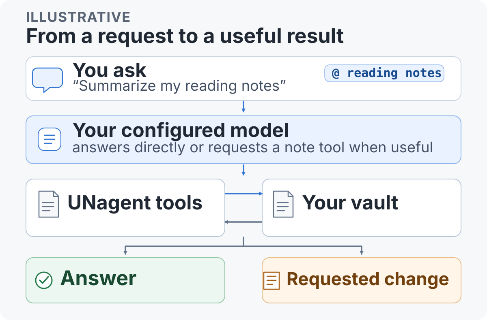
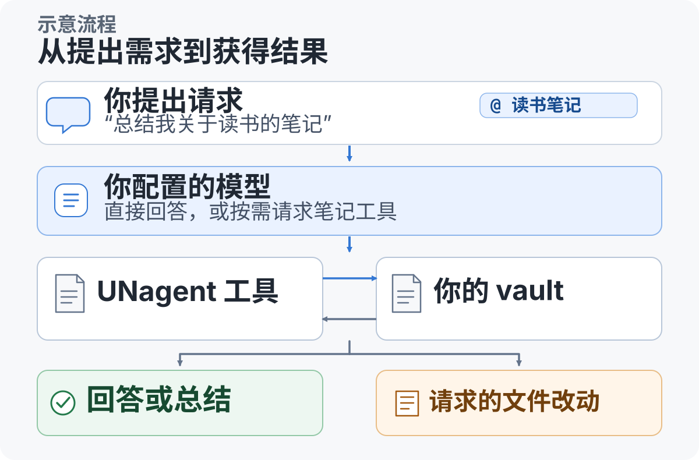

# UNagent

**Use an AI assistant to search, understand, and update your Obsidian notes—with clear controls over what it can change.**

Connect your own model provider and API key; UNagent sends requests directly to that provider. See [Data and safety](#data-and-safety) for what leaves Obsidian and how file changes are reviewed.

[中文文档](#中文文档) · [Install from Obsidian](https://community.obsidian.md/plugins/unagent) · [Releases and update notes](https://github.com/UNcore-gh/UNagent/releases)

<p align="center">
  
</p>

*Illustrative flow. A request does not always call a tool; file review follows the action and approval mode.*

## What you can do

- **Ask questions about your notes.** Search and read Markdown notes, then discuss the results with the model. Optional semantic search uses a remote embedding service and keeps its vector cache in the vault.
- **Make changes with review.** In the default and automatic approval modes, create and edit actions run first and appear as cards you can accept or reject; edits include a diff. Moves and deletions ask first, and note/folder deletion always asks. Supported edits and deletions can be undone from a saved snapshot.
- **Bring the assistant to your current work.** Open the chat, or use the Quick Composer over a note, Canvas, Excalidraw, PDF, or a UNreader book/article view. The Quick Composer sends into the same conversation as the chat.
- **Choose your interface language.** UNagent follows Obsidian's language by default. To set it manually, open **Settings → UNagent → General → Language & appearance → Language mode** and choose **English mode** or **Chinese mode**.
- **Reference related material.** In the composer, `@` selects notes, `@@` folders, and `@@@` tags. If UNreader or UNmemos is installed, entry rows also let you select RSS articles or memo cards.
- **Read more than notes.** `book_read` reads EPUB, FB2, MOBI, AZW3, and TXT files. `fetch_url` converts a web page to Markdown. Neither is a general PDF or office-document reader.
- **Collaborate across conversations.** Enable collaboration for selected chats, reference them from the `@` conversation entry, or ask them to perform a task. Each chat retains its own model and workspace; inserting a reference alone does not start a task.
- **Learn with `teach`.** This optional preset builds a learning workspace with short lessons, practice and learning records. It is enabled by default; your existing skill with the same name takes priority.
- **Add optional guidance and tools.** Skills are plain-text guides. Remote MCP servers can add tools, but they are optional and should only be connected when trusted.

## Quick start

UNagent uses your own model account. Provider usage fees, if any, are billed by that provider.

### 1. Install

**Recommended:** in Obsidian, open **Settings → Community plugins → Browse**, search for **UNagent**, then choose **Install** and **Enable**.

To install or update manually, download the three files from the [latest GitHub Release](https://github.com/UNcore-gh/UNagent/releases) and place them in your vault:

```text
<your vault>/.obsidian/plugins/unagent/
├── main.js
├── manifest.json
└── styles.css
```

In Obsidian, go to **Settings → Community plugins**, enable **UNagent**, then open it from the ribbon icon or the **Open UNagent chat** command.

### 2. Connect a model

Open **Settings → UNagent → Models → + Add provider**. Choose OpenAI-compatible, Anthropic, or OpenAI Responses; enter the provider's API key; then add a model name. The default API address is filled in for the selected protocol and can be changed.

### 3. Start with one request

For example: “Search my notes about reading and summarize the main ideas.” You can switch models with `/model`, set reasoning with `/think`, or choose a search mode with `/search`.

In the default and automatic approval modes, create/edit actions appear in a review card after they run. Read the [approval and security boundaries](#data-and-safety) before using tools that change files or call remote services.

## Optional external agents

For Codex or Claude Code on the same computer, open **Settings → UNagent → General → External AI communication**. Install the separate [UNagent Connect 0.2.1 package](https://github.com/UNcore-gh/unagent-connect/releases/tag/0.2.1) and follow its installation and pairing guide. The Hub requires Node.js 22.13 or newer. Automatic execution is off by default and requires explicit setup; pairing does not launch an agent. The original manual bridge remains supported. Phone/tablet access to a computer’s local Hub is not supported.

## Data and safety

- **Your model provider receives the conversation context it needs.** This can include note excerpts and tool results. UNagent does not provide a proxy, account, telemetry, or analytics service.
- **Collaboration shares the task and necessary context with its recipient.** This can include selected notes and results sent to that recipient’s configured model provider. Only chats you enable for collaboration are discoverable. External connections use authenticated local HTTP; do not pair untrusted agents. Approvals remain with the user in the receiving application, and interrupted work is not replayed automatically.
- **API keys are stored as plain text** in the vault's `data.json`. Keep that file private; do not commit it or place it in a publicly synced folder.
- **Network use is optional by feature.** Model requests go to your configured provider. Semantic search uses a remote embedding API if enabled. MCP calls go to servers you add. `fetch_url` sends the requested URL to that website, and the page text can then enter the model context.
- **`fetch_url` does not block private or local network addresses.** Use it only with URLs you trust. It refuses binary files and non-HTTP(S) schemes.
- **Skills are instructions, not programs.** Their text is added to the model context, so use skills only from sources you trust.
- **MCP servers are remote and outside the vault's undo system.** Their annotations are supplied by the server and are not proof that a tool is safe. Connect only servers you trust.
- **Deletion is guarded.** `delete_note` and `delete_folder` always ask before running. Undo snapshots for folder deletion are limited to text files and at most 200 files / 500 KB; larger or non-text folders cannot be restored by UNagent's undo.
- **Desktop-only shell access:** `run_command` runs commands on your computer and is available only on desktop. Commands the plugin can prove are read-only can skip confirmation when that setting is enabled; other commands ask every time. You can turn off read-only command skipping in Settings → Security.

## Compatibility and limits

- The release manifest declares **Obsidian 1.7.2** as the minimum app version and is not desktop-only.
- Chat and vault tools are available on mobile and desktop. `run_command` is the one desktop-only tool.
- Version 1.1.0 was checked against live model services and in phone/tablet emulation. Physical-device keyboards, system gestures and background behavior remain unverified.
- Vault search covers Markdown notes. It does not search inside images, PDFs, or ebooks.
- `book_read` supports EPUB, FB2, MOBI, AZW3, and TXT. DRM-protected books are not supported. PDF and Office documents are not read by UNagent.
- UNreader article references and UNmemos card references appear only when the corresponding plugin provides its data.

## Releases and source

Obsidian delivers plugin updates through its official Community plugin channel. See [GitHub Releases](https://github.com/UNcore-gh/UNagent/releases) for published versions and their update notes.

## More from UNcore

- [UNreader](https://community.obsidian.md/plugins/unreader) — Read ebooks and manage RSS feeds inside Obsidian.
- [UNmemos](https://community.obsidian.md/plugins/unmemos) — Capture short notes as native Canvas cards, stored locally.

## License

**UNcore Source Available License** — source-visible, not an open-source license. Reading and auditing the source is permitted for Obsidian's plugin review and personal learning or research. Commercial use, modification, redistribution, and republishing require prior written permission. The Community directory marks the listing as privately source-reviewed; the public repository contains a minified `main.js`, while the source is kept in a private repository for review. See [LICENSE](LICENSE). The bundled `teach` preset is adapted from [Matt Pocock’s skills](https://github.com/mattpocock/skills/tree/ad5400b930b297b0c0cb231ff1ffe42a7da666aa/skills/productivity/teach) under the MIT license; its attribution and license are included in the preset and LICENSE.

---

# 中文文档

**在 Obsidian 里用 AI 搜索、理解和整理笔记，并清楚掌握它能改什么。**

连接你自己的模型服务和 API Key；UNagent 会直接向该服务发送请求。关于哪些内容会离开 Obsidian、文件改动如何复核，请先看[数据与安全边界](#数据与安全边界)。

[English](#unagent) · [从 Obsidian 安装](https://community.obsidian.md/plugins/unagent) · [版本与更新说明](https://github.com/UNcore-gh/UNagent/releases)

<p align="center">
  
</p>

*示意流程：每次请求不一定调用工具；文件复核方式取决于动作和审批模式。*

## 能做什么

- **围绕笔记提问。** 搜索、阅读 Markdown 笔记，再和模型讨论结果。可选语义检索会使用远程向量服务，并把向量缓存保存在 vault 中。
- **改动有确认。** 默认和自动审批模式下，新建与编辑动作执行后会显示卡片供你接受或拒绝；编辑卡片带差异对比。移动和删除会先询问，删除笔记与文件夹无论审批模式都会先询问。支持的编辑和删除可以通过保存的快照撤销。
- **在当前页面快速提问。** 可以打开对话面板，也可以在笔记、Canvas、Excalidraw、PDF 或 UNreader 的书籍/文章页面上打开正文快速输入框。它和对话面板共用同一段会话。
- **选择界面语言。** 默认跟随 Obsidian 的语言；也可以在**设置 → UNagent → 通用 / General → 语言与外观 / Language & appearance → 语言模式 / Language mode**中选择**英文模式 / English mode**或中文模式。
- **引用相关内容。** 输入框里用 `@` 找笔记、`@@` 找文件夹、`@@@` 找标签。安装 UNreader 或 UNmemos 后，还能从入口行选择 RSS 文章或卡片。
- **读取网页和电子书。** `book_read` 支持 EPUB、FB2、MOBI、AZW3、TXT；`fetch_url` 把网页转成 Markdown。它们都不是通用 PDF 或办公文档阅读器。
- **让多个对话协作。** 为选定对话开启协作后，可从 `@` 的「对话」入口引用它，也可明确要求它接收任务。各对话保留自己的模型与工作范围；插入引用本身不会派任务。
- **用 `teach` 持续学习。** 通过短课、练习和学习记录建立学习工作区。该预设默认开启、可以关闭；你已有的同名技能优先。
- **按需扩展。** Skill 是纯文本操作指南；远程 MCP 服务可以增加工具，但都是可选项，只连接你信任的服务。

## 快速上手

UNagent 使用你自己的模型账户；如服务商收费，费用由服务商收取。

### 1. 安装

**推荐方式：**在 Obsidian 打开**设置 → 第三方插件 → 浏览**，搜索 **UNagent**，然后点击**安装**和**启用**。

如需手动安装或更新，从[最新 GitHub Release](https://github.com/UNcore-gh/UNagent/releases)下载三个文件，放到 vault：

```text
<你的 vault>/.obsidian/plugins/unagent/
├── main.js
├── manifest.json
└── styles.css
```

然后在 Obsidian **设置 → 第三方插件**中启用 **UNagent**，通过左侧栏图标或命令面板里的 **Open UNagent chat** 打开。

### 2. 连接模型

打开 **设置 → UNagent → 模型 → + 添加厂商**。选择 OpenAI 兼容、Anthropic 或 OpenAI Responses 协议，填写服务商 API Key，再添加模型名称。选择协议后会预填 API 地址，你也可以修改。

### 3. 试着提出一个请求

例如：“搜索我关于读书的笔记，并总结主要观点。”你可以用 `/model` 切换模型、用 `/think` 设置思考强度、用 `/search` 选择检索模式。

默认和自动审批模式下，新建/编辑动作执行后会进入复核卡片。使用会改文件或访问网络的工具前，请先阅读[审批与安全边界](#数据与安全边界)。

## 可选的外部 AI 通讯

需要连接同一台电脑上的 Codex 或 Claude Code 时，打开**设置 → UNagent → 通用 → 外部 AI 通讯**，安装独立的 [UNagent Connect 0.2.1 通讯包](https://github.com/UNcore-gh/unagent-connect/releases/tag/0.2.1)，按包内说明安装与配对。Hub 需要 Node.js 22.13 或更新版本；自动执行默认关闭，需明确配置，配对本身不会启动外部 Agent。原有手动桥接仍保留。不支持手机／平板连接电脑上的本机 Hub。

## 数据与安全边界

- **模型服务商会收到对话所需的上下文。** 其中可能包括笔记摘录和工具结果。UNagent 不提供代理、账号、遥测或统计服务。
- **协作会把任务及必要资料交给接收方。** 其中可能包含选定的笔记和结果，并进入接收方所配置模型的上下文。只有你开启协作的对话才可被发现；外部接入使用经过认证的本机 HTTP，不要配对不可信 Agent。操作确认仍由接收软件中的用户处理，中断任务不会自动重做。
- **API Key 以明文保存在 vault 的 `data.json` 中。** 请妥善保管，不要提交到 Git，也不要放在公开同步目录。
- **联网按功能发生。** 模型请求发往你配置的服务商；启用语义检索时会调用远程向量服务；MCP 请求发往你添加的服务器；`fetch_url` 会把网址发给对应网站，网页正文之后也可能进入模型上下文。
- **`fetch_url` 不拦截内网或本机地址。** 只打开你信任的网址。它会拒绝二进制文件和非 HTTP(S) 地址。
- **Skill 是提示文本，不是程序。** 它的内容会交给模型，因此只使用可信来源的 Skill。
- **MCP 服务在远端运行，不受 vault 撤销功能保护。** 工具安全标记由服务端提供，不能证明工具一定安全。只连接你信任的服务。
- **删除有保护。** `delete_note` 和 `delete_folder` 执行前总会询问。文件夹删除的撤销快照最多保存 200 个文件或 500 KB，且仅支持文本文件；超出范围时，UNagent 无法通过撤销恢复。
- **桌面专属的本地命令：** `run_command` 会在你的电脑上运行命令，只在桌面端提供。开启只读命令免确认后，插件能证明为只读的命令可跳过确认；其余命令每次都会询问。可在设置 → 安全中关闭这项免确认。

## 兼容性与限制

- 发布包的 manifest 声明最低支持 **Obsidian 1.7.2**，插件并非桌面专用。
- 移动端和桌面端都可使用对话与 vault 工具；`run_command` 是唯一的桌面专属工具。
- 1.1.0 已使用真实模型服务及手机／平板模拟环境检查；真机键盘、系统手势与后台行为仍未覆盖。
- 库内搜索只覆盖 Markdown 笔记，不会搜索图片、PDF 或电子书内部内容。
- `book_read` 支持 EPUB、FB2、MOBI、AZW3、TXT，不支持 DRM 保护的书籍。UNagent 不读取 PDF 和办公文档。
- RSS 文章与 UNmemos 卡片引用，需要相应插件提供数据后才会出现。

## 版本与源码

插件更新通过 Obsidian 官方第三方插件渠道提供；已发布版本和对应更新说明见 [GitHub Releases](https://github.com/UNcore-gh/UNagent/releases)。

## UNcore 的其他 Obsidian 插件

- [UNreader](https://community.obsidian.md/plugins/unreader) —— 在 Obsidian 中阅读电子书并管理 RSS 订阅。
- [UNmemos](https://community.obsidian.md/plugins/unmemos) —— 把短想法保存为 Canvas 原生卡片，数据留在本地。

## 许可证

**UNcore Source Available License**——源码可见，但不是开源许可证。允许为 Obsidian 官方审核、个人学习或研究阅读和审计源码；商业使用、修改、再分发和再发布需事先取得书面许可。社区目录显示本插件的私有源码已通过审核；公开仓包含压缩后的 `main.js`，源码保存在私有审核仓库。详见 [LICENSE](LICENSE)。内置 `teach` 预设改编自 [Matt Pocock 的 skills](https://github.com/mattpocock/skills/tree/ad5400b930b297b0c0cb231ff1ffe42a7da666aa/skills/productivity/teach)，该部分遵循 MIT 许可，署名及许可全文保留在预设和 LICENSE 中。
